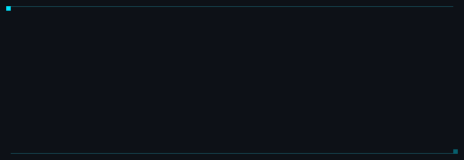

<!--
ARTEMIS // GitHub Profile README
Copy README.md into the root of the mtf-samee/mtf-samee repository.
Keep the assets/ folder beside README.md so the local GIFs load.
-->

  

## `00 / la DOSSIER`

<table align="center" border="1" bordercolor="#00E5FF" cellpadding="10" cellspacing="0" bgcolor="#0D1117">
  <tr>
    <td align="center" bgcolor="#0D1117">
      
    </td>
  </tr>
</table>

  

---

## `01 / la TELEMETRY`

<table align="center" width="100%" cellpadding="18" cellspacing="0" border="1" bordercolor="#164E63">
  <tr>
    <td align="center" width="33%" valign="top" bgcolor="#0D1117">
      
      <h3>ARCHITECTURE</h3>
      Full-stack engineering  
      Desktop applications  
      Backend and system logic
    </td>
    <td align="center" width="34%" valign="top" bgcolor="#0D1117">
      
      <h3>SECURITY</h3>
      Network vulnerability analysis  
      Infrastructure auditing
    </td>
    <td align="center" width="33%" valign="top" bgcolor="#0D1117">
      
      <h3>HARDWARE</h3>
       
      Embedded Systems 
       
      Digital logic and circuits
    </td>
  </tr>
</table>

## `02 / la QUIVER`

<strong>LANGUAGES &amp; SYSTEMS</strong>

  

<strong>APPLICATIONS &amp; APIS</strong>

  

<strong>DATA, EMBEDDED &amp; DEPLOYMENT</strong>

  

---

## `03 / EXECUTED PAYLOADS`

<table width="100%" cellpadding="12" cellspacing="0" border="1" bordercolor="#164E63">
  <tr bgcolor="#0D1117">
    <th align="left">PROJECT</th>
    <th align="left">MISSION PROFILE</th>
    <th align="center">STACK</th>
  </tr>
  <tr>
    <td><strong>Freeze Pharm</strong></td>
    <td>Autonomous pharmaceutical cold-chain IoT monitor.</td>
    <td align="center"></td>
  </tr>
  <tr>
    <td><strong>Linux Desktop Utilities</strong></td>
    <td>Standalone AppImage tools, including a Pomodoro timer and alarm clock.</td>
    <td align="center"></td>
  </tr>
  <tr>
    <td><strong>Hospital OS</strong></td>
    <td>Comprehensive healthcare administration and data platform.</td>
    <td align="center"></td>
  </tr>
  <tr>
    <td><strong>Logic Design</strong></td>
    <td>Three-bit rotator circuit built from basic logic gates and multiplexer structures.</td>
    <td align="center"><code>Logisim</code> <code>Digital Logic</code></td>
  </tr>
</table>

## `05 / CONTACT`

  
  

  
  
  
  

  <a href="tel:+8801518785874">Tap here to call +8801518785874</a>

## `04 / The OLYMPUS`

  
  

  

  

---

  <code>TRACE THE SIGNAL.</code> &nbsp; <code>UNDERSTAND THE SYSTEM.</code> &nbsp; <code>BUILD WITH INTENT.</code>

  

